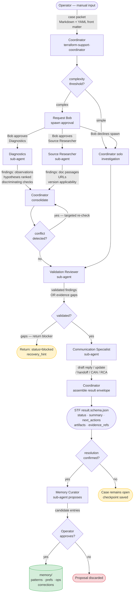
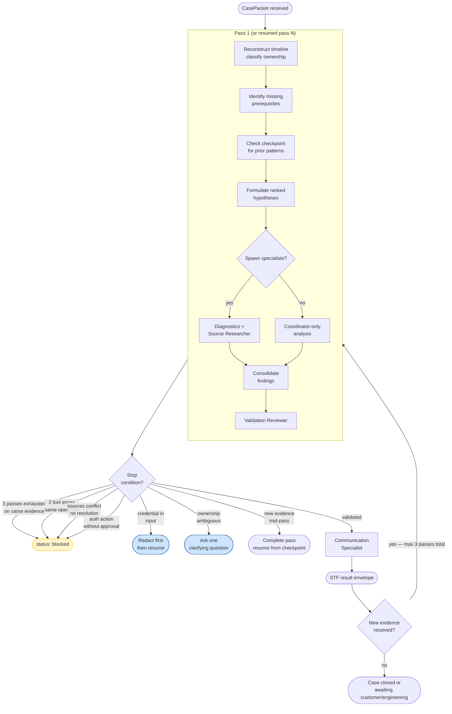
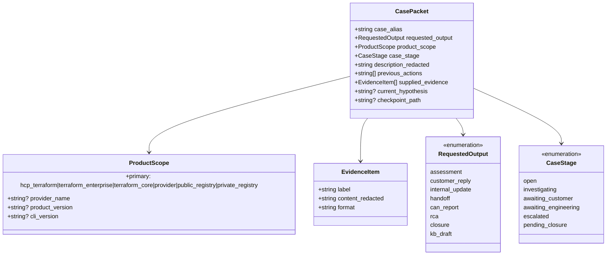
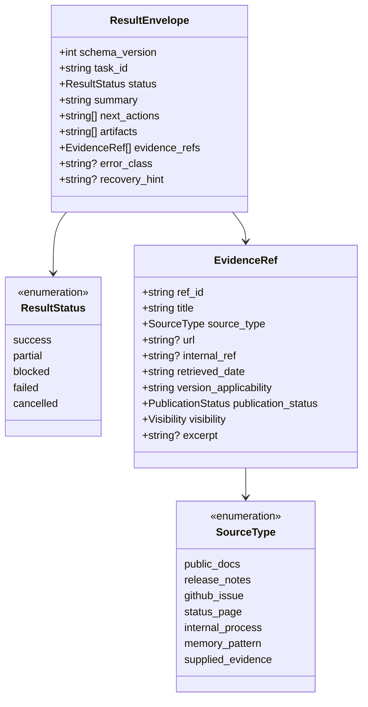
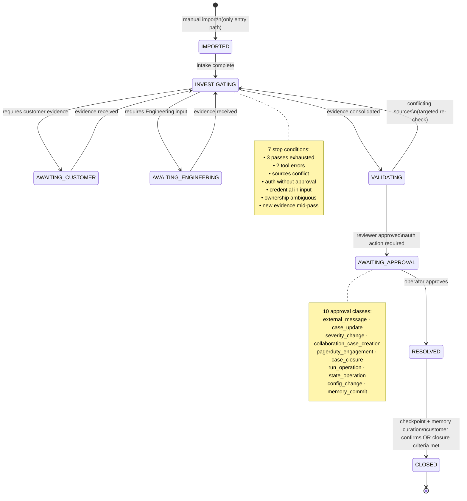
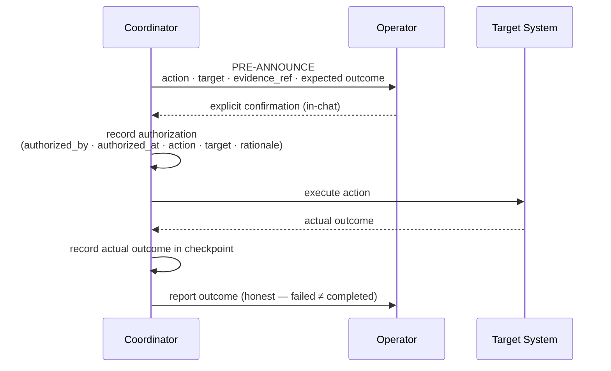
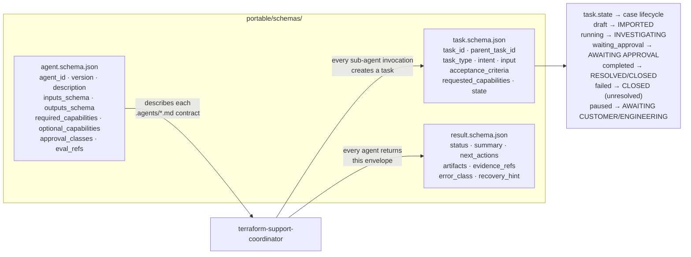

# Design 00a — Architecture and Data-Flow Diagrams

> **Status**: Draft — awaiting operator review.
> **Prepared**: companion to `00-overview.md` and `01-coordinator-contract.md`.  
> **Scope**: Design-phase Mermaid diagrams only. No runnable code is created.

---

## 1. End-to-end system flow



---

## 2. Investigation loop (bounded 3-pass)



---

## 3. Input — CasePacket structure



---

## 4. Output — STF result envelope



---

## 5. Memory and local storage layout

```mermaid
flowchart LR
    subgraph SESSION["Session memory (not persisted)"]
        WC[Working context\nredacted excerpts\ntemp analysis]
    end

    subgraph CHECKPOINTS["checkpoints/  (human-approved)"]
        CD["checkpoints/draft/\ncurrent-pass-N.md\n─ staging area"]
        CP["checkpoints/CASE-alias-pass-N.md\n─ promoted after approval"]
        CD -->|operator approves\npromotion| CP
    end

    subgraph MEMORY["memory/  (human-approved, in agent repo)"]
        PAT["patterns/\n<slug>.md\ncandidate→validated→outdated"]
        PREF["preferences.md\nresponse style · signature\ntemplates · handoff fields"]
        OPS["ops/<topic>.md\ninternal process refs\nrouting conditions\nsession-scoped by default"]
        CORR["corrections/<slug>.md\npermanent audit\naccepted corrections"]
    end

    CURATOR[Memory Curator\nsubagent proposes]
    CURATOR -->|proposes candidate| CD
    CURATOR -->|proposes pattern| PAT
    CURATOR -->|proposes pref update| PREF
    CURATOR -->|proposes correction| CORR

    OPERATOR([Operator approves]) -->|per write| CP
    OPERATOR -->|per write| PAT
    OPERATOR -->|per write| PREF
    OPERATOR -->|per write| OPS
    OPERATOR -->|per write| CORR

    COORD[Coordinator] -->|reads\n(not writes)| CP
    COORD -->|reads| PAT
    COORD -->|reads| PREF
    COORD -->|reads| OPS
    COORD -->|writes draft\nonly| CD

    note1["⚠ memory/ is NOT .memory/\n.memory/ = STF project governance\nmemory/ = terraform agent's own repo\n(separate repo, Phase 3)"]

    style CD fill:#fff3cd,stroke:#ffc107
    style note1 fill:#f8d7da,stroke:#dc3545,color:#333
```

---

## 6. Case lifecycle state machine



---

## 7. Approval gate — per-action protocol



---

## 8. STF schema alignment



---

*Previous: [`00-overview.md`](00-overview.md) | Part of design set — see also [`01-coordinator-contract.md`](01-coordinator-contract.md) and [`04-memory-and-evidence-schemas.md`](04-memory-and-evidence-schemas.md)*
